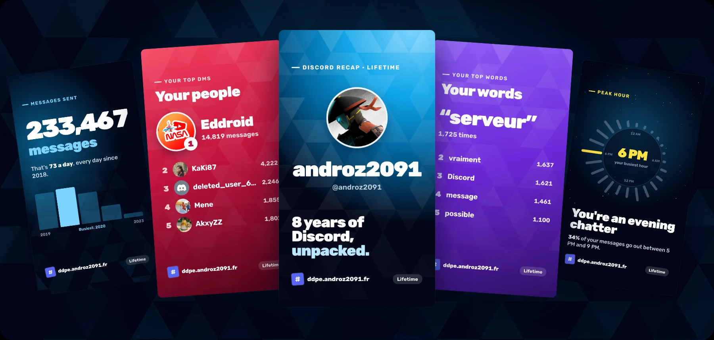
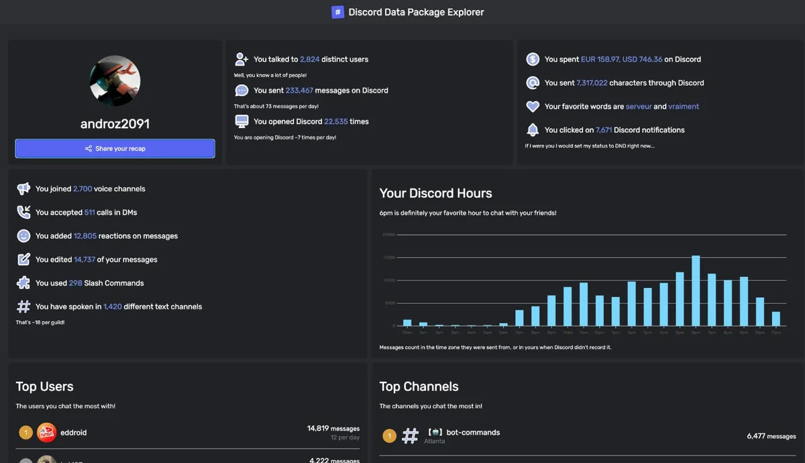
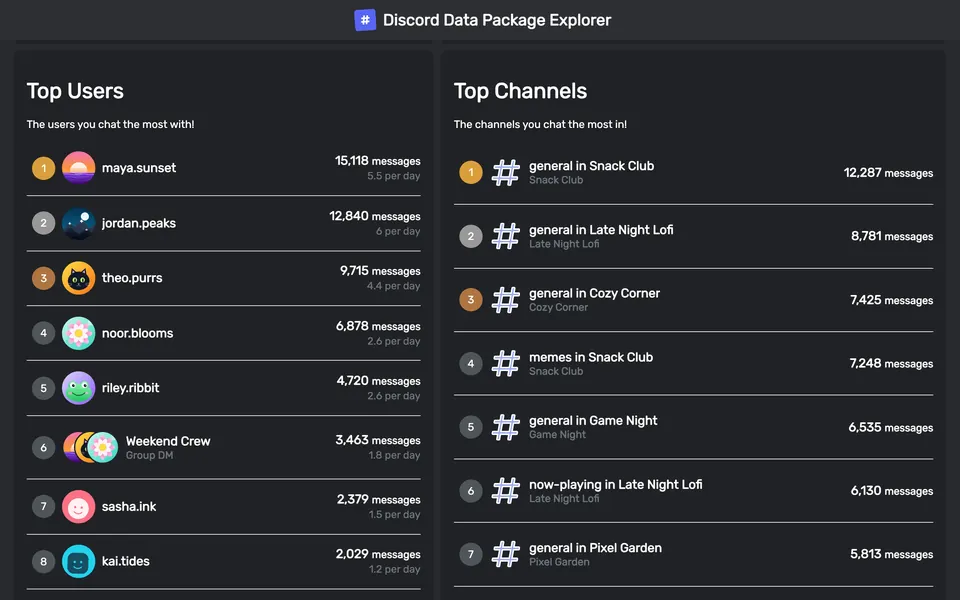
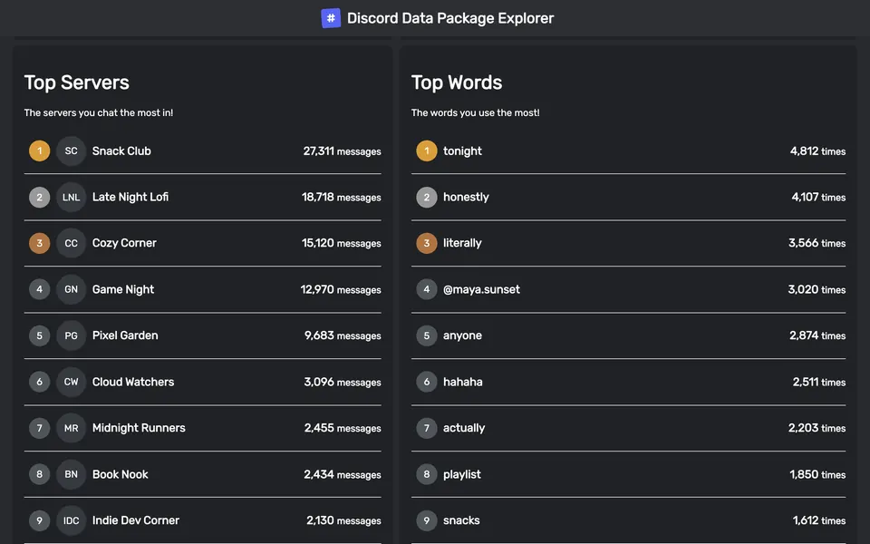
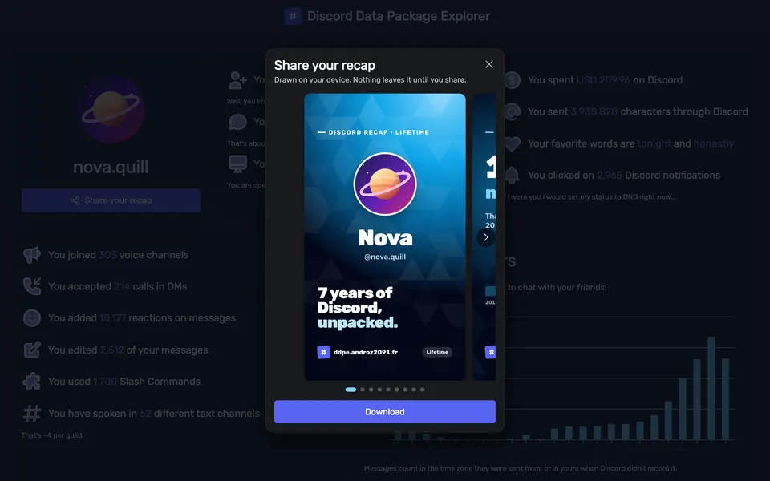

  

<h1 align="center">Discord Data Package Explorer</h1>

  <b>What's really in your Discord data package?</b> DDPE reads the package Discord gives you, right in your browser, shows who you talk to, where you hang out and when you're online, and turns it into cards to share.

  

  <a href="https://ddpe.androz2091.fr/stats/demo">Try the demo</a> · <a href="https://androz2091.fr/discord">Our Discord server</a>

## What you get

<table>
  <tr>
    <td align="center" width="50%"></td>
    <td align="center" width="50%"></td>
  </tr>
  <tr>
    <td align="center">Your numbers and your Discord hours</td>
    <td align="center">Who you talk to, and where</td>
  </tr>
  <tr>
    <td align="center"></td>
    <td align="center"></td>
  </tr>
  <tr>
    <td align="center">Your servers and your words</td>
    <td align="center">Cards to share</td>
  </tr>
</table>

- Hours are counted in the time zone each message was sent from.
- Group DMs rank among your top users, each with its messages a day.
- Share 8 story cards and a square summary, drawn on your device.

The screenshots and cards show a made-up account.

## Your data stays in your browser

- DDPE opens your package and reads it in your browser: the zip is never uploaded.
- The stats it finds are saved in your browser's local storage, so the page survives a reload. Loading another package replaces them.
- To show names and avatars, it sends user IDs, yours and those of the people in your top lists, to [diswho](https://github.com/Androz2091/deno-diswho), which asks Discord's API, and loads the avatars from Discord's CDN. diswho asks you to solve a captcha first.
- Share cards are drawn on your device, and leave it only when you share or download one.
- The hosted site counts visits with [Umami](https://umami.is). Every copy loads its font from Google Fonts, and its contributors list and help video from GitHub.
- When a package can't be read, DDPE offers a prefilled GitHub issue with the error, your browser and the package's folder names. Nothing is sent unless you post it.

## Get your Discord package

1. In Discord, open **User Settings** > **Privacy & Safety** and click **Request Data**. Select at least **Account info** and **Messages**: **Activity** adds app opens, notifications, reactions and voice.
2. Discord emails you a download link once your package is ready.
3. Open [DDPE](https://ddpe.androz2091.fr) and select your `package.zip`, as Discord sent it.

## Run it yourself

DDPE is a [Svelte](https://svelte.dev) app.

- With Docker: `docker compose up -d`, then open http://localhost:5000.
- With Node.js 22: `corepack enable`, `yarn install`, then `yarn dev`.

`.env` points at the hosted diswho and Umami. Set `VITE_DISWHO_URL`, `VITE_ANALYTICS_URL` and `VITE_ANALYTICS_WEBSITE_ID` in `.env.local` or in the build's environment to use your own, or leave `VITE_ANALYTICS_URL` empty to load no analytics.

## On your phone

[Dumpus](https://dumpus.app) is the next version of DDPE, an app for iOS, Android and desktop. It processes your package on its server rather than in your browser.

## Credits

DDPE was created after a discussion with [Kaki87](https://kaki87.net), an awesome developer who taught me a lot of things. He had in mind to create this app but didn't have the time for it, so I learned Svelte and built it as a side project. It would never have existed without him! 🙏

DDPE is licensed under [GPL-3.0](LICENSE).
